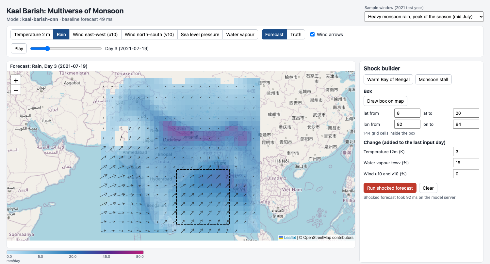
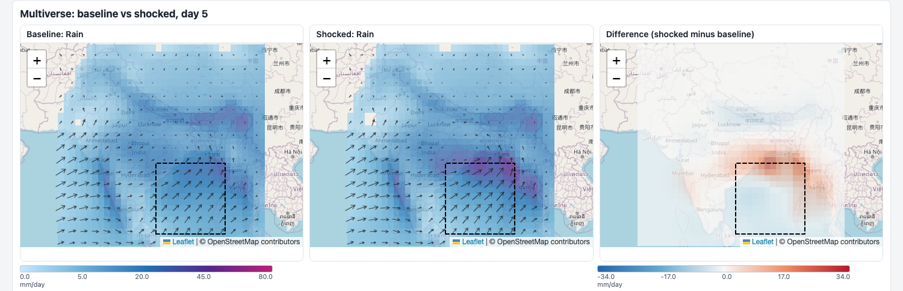
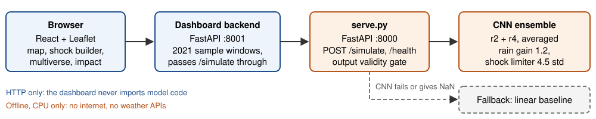

# Kaal Barish: a digital twin of India's weather

Sarthak Rawool, Aditya Nayak, Aditya Pawar · DevForge Track 2 · github.com/AdityaNayak12/kaal-barish

**USP.** An offline, local residual-CNN digital twin of India's weather that rolls out 10 days stably.
A "what if" shock stays local on day 1 and then spreads at a physical pace.

## 1. Model design

**Architecture.** Each step sees the last 3 days (6 channels; rain through log1p), the climatology of the target day,
static maps (land-sea mask, orography, lat/lon) and the day of year. A residual CNN (input convolution, 3 residual
blocks, width 64, all 3×3) predicts the next day, and the forecast is rolled out day by day. The 3×3 stack limits how
far information moves: on day 1 a shock can only reach about 7 cells, apart from the small GroupNorm leak (see
Failure modes). We ship a 2-member ensemble (r2 and r4, two seeds, rollouts averaged), with output rain × 1.2
(chosen on 2020) to catch heavy rain. The server then blends the unshocked forecast's non-rain channels (not v10)
with a linear baseline, weights chosen on 2020; a shock adds the CNN's own response.

**Preventing drift and blur.** (1) *Predict the change from today*; the output layer starts at zero, i.e. at
persistence. (2) *Climatology as an input*, so relaxing towards the seasonal normal is easy to learn.
(3) *Curriculum*: 1-step, then 4-step, then 8-step training rollouts, so it learns from its own errors. (4) *Shock-response limiter*: a shocked run stays within 4.5 channel stds per cell of the
unshocked run, every step, which stops rare rain blow-ups.

**Honest validation.** Train 2005–2019 (climatology and normalisation too); every choice (rain gain, ensemble
members) made on 2020 (r3 was also rejected for its 2021 loss); 2021 as the check; 2022 never used for any choice.
Kit scoring, 40 windows per year:

| part | val 2020 | test 2021 | held-out 2022 |
|---|---|---|---|
| Forecast RMSE skill /30 (SS) | 30.00 (0.141) | 30.00 (0.130) | 30.00 (0.135) |
| Heavy-rain CSI /15 · Causality /15 | 13.16 · 13.83 | 15.00 · 13.31 | 14.16 · 13.78 |
| Anti-blur /10 · Repo scan /15 | 10.00 · 15.00 | 10.00 · 15.00 | 10.00 · 15.00 |
| **Auto total /85** | **81.99** | **83.31** | **82.94** |

SS is skill vs the better of persistence and climatology. The judge scores only 5 windows and RMSE points are capped at the mean: over 2000
random 5-window draws the expected RMSE + CSI is 39.5 / 41.2 / 40.7 of 45 (2020 / 2021 / 2022), so a **realistic
total is about 78–80 of 85**. No clear sign of overfitting: r2's training years 2012 / 2017 score about 0.02 higher in skill
(0.130 / 0.140 vs 0.118 / 0.109 on 2020 / 2021), under our 0.03 flag; heavy-rain skill shows a slight gap (+0.045). 2022 lands between 2020 and 2021 (scoring every day of 2022, 364 windows, gives 83.57 / 85).

**Failure modes, stated openly.**

- **The monsoon-stall shock fades.** After a one-off −40% wind kick, the day-8 response has 3–9% of its day-1 energy.
  The kit's "propagates" check passes in 23 / 32 / 53 / 44% of windows (DJF / MAM / JJAS / ON), vs 63 / 84 / 88 / 96%
  for the warm Bay of Bengal. Cause: the model is atmosphere-only, with no ocean or land memory; outside the monsoon
  the kick only triggers a pressure adjustment (msl and v10 carry 66% of the late response in DJF) that decays in
  2–3 days, while in JJAS it changes rain (63%).
- **GroupNorm leak.** GroupNorm's whole-grid statistics leak a little of any shock everywhere; most of the stall's
  far-field spread is this artefact: freezing the statistics drops its propagation from 38% to 11% (season average;
  53% → 8% in JJAS, 23% → 3% in DJF). The ensemble cut the warm-ocean day-1 far leak (JJAS) from about 60 cells
  to 7.
- **Biases.** Rain is the weakest channel (2022 SS 0.099; the blend lifted t2m from 0.087 to 0.118). 2021–22 ran
  0.23–0.25 K above the 2005–2019 climatology and the forecast is 0.16–0.18 K cold at day 8. Rain is about
  +0.5 mm/day wet at day 1 (+0.1–0.4 by day 8), the price of the 1.2 gain. Winter rain can blur: on the 11 DJF windows of our 2022 set the day-8 rain field keeps 33%
  of the real spatial variance (bar 40%), but 64% averaged over every DJF day.
- **Tried and rejected.** *Per-cell norm (r3)*: removed most of the leak but cut stall propagation from 0.37 to 0.02
  (2020) and lost 2.5 points on 2021. *Decaying forcing* (re-inject 0.7k+1 × shock): +0.25 / 15
  causality on 2020, +0.08 on 2021, stall still below target. *A third member*: 81.67 vs 81.99 (2020).

## 2. Visualisation and impact

Figure 1. Live forecast (rain, day 3, mid-July 2021) with wind arrows, day slider, a Forecast /
Truth switch (ERA5) and the shock builder set to the warm Bay of Bengal preset.

**What a planner can ask:** *"What if the Bay of Bengal is 3 K warmer?"* Pick one of 10 real 2021 windows (cyclones
Tauktae, Yaas and Gulab, two heatwaves, monsoon onset and peak, October rain, two winter windows), apply a preset or
draw any box, set the change in temperature, water vapour and wind, and run. The dashboard shows where the two
futures split, day by day, and what it means on the ground: which regions get more heatwave days and which lose rain.

Every map is a fresh `/simulate` call on the running model; nothing is pre-rendered.

Figure 2. Multiverse view for the warm Bay of Bengal (+3 K t2m, +15% water vapour in 8–20 N,
82–94 E), day 5: baseline, shocked and their difference, animated with the day slider. The difference shows more
rain (red) along the north of the box, at the head of the Bay over the Odisha–Bangladesh coast and off Myanmar, and
slightly less (blue) over the southern half of the box. A bar row (cropped here) counts cells whose rain changed by
more than 0.5 mm/day: 509 on day 1 (186 of them beyond the CNN's 7-cell daily reach: the GroupNorm leak, about
1 mm/day each), peaking at 611 on day 2.

Figure 3. Impact panel, same shock. Left: land cell-days above a heat threshold (slider, default
34 °C) by region, ranked, with the change from baseline (a baseline list sits beside it). Right: 10-day rain per
region, baseline vs shocked. Regions are 9 rough boxes on 1° cells, so a scenario is a sensitivity test for planners
(disaster response, agriculture, power demand), not a local forecast.

Figure 4. System. serve.py blends the CNN's unshocked t2m, u10, msl and tcwv with the linear
baseline (weights per lead and channel, fit on 2020); rain and v10 stay pure CNN. Fully offline and CPU only: in a Docker run from a fresh clone (4 CPUs, no
network) <code>/health</code> is ready in under 2 s, the server peaks at about 340 MB and a 10-day call takes 0.1–0.3 s of
server time. Capping CPU threads at 4 cut the slowest shock call from 3.4 s to 0.46 s on an older torch.

