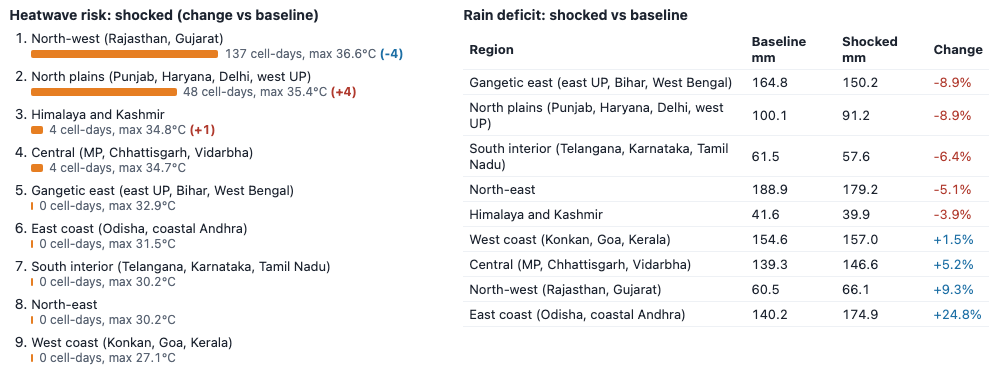

# Kaal Barish: a digital twin of India's weather

Sarthak Rawool, Aditya Nayak, Aditya Pawar · DevForge Track 2, "Multiverse of Monsoon" · github.com/AdityaNayak12/kaal-barish

**USP.** An offline, local residual-CNN digital twin of India's weather that rolls out 10 days stably.
A "what if" shock stays local on day 1 and then spreads at a physical pace, never jumping across the map.

## 1. Model design

**Architecture.** Each step sees the last 3 days (6 channels, standardised, rain through log1p), the climatology of
the target day, static maps (land-sea mask, orography, lat/lon) and the day of year. A residual CNN (input
convolution, 3 residual blocks, width 64, all 3×3) predicts the next day, and the forecast is rolled out day by day.
The 3×3 stack lets information move about 7 cells per day, so a shock cannot appear far away on day 1. We ship a
2-member ensemble (r2 and r4: same recipe, different seed) whose rollouts are averaged, with output rain × 1.2
(chosen on 2020) to catch heavy rain.

**Preventing drift and blur.**
(1) *Predict the change from today*, not the whole state; the output layer starts at zero, so an untrained step is
persistence. (2) *Climatology as an input* (climatology minus today), so relaxing towards the seasonal normal is easy
to learn and long rollouts do not wander off. (3) *Curriculum*: 1-step, then 4-step, then 8-step training rollouts,
so the model learns from its own errors instead of blurring by day 8. (4) *Shock-response limiter*: a shocked run
stays within 4.5 channel stds per cell of the unshocked run, every step. It stops rare rain blow-ups and leaves
unshocked forecasts bit-identical.

**Honest validation.** Train 2005–2019; every choice (rain gain, ensemble members) made on 2020; 2021 as the check;
2022 never used for anything. Climatology and normalisation statistics
reproduce exactly from 2005–2019 alone. Local auto-score with the kit's scoring code, 40 windows per year:

| part | val 2020 | test 2021 | held-out 2022 |
|---|---|---|---|
| Forecast RMSE skill /30 (SS) | 30.00 (0.132) | 30.00 (0.123) | 30.00 (0.129) |
| Heavy-rain CSI /15 | 13.16 | 15.00 | 14.16 |
| Anti-blur /10 · Repo scan /15 | 10.00 · 15.00 | 10.00 · 15.00 | 10.00 · 15.00 |
| Perturbation causality /15 | 13.83 | 13.31 | 13.78 |
| **Auto total /85** | **81.99** | **83.31** | **82.94** |

SS is skill against the better of persistence and climatology; against persistence alone at day 4 it is 0.25 (2021)
and 0.22 (2022), and 1 of 40 windows loses in each year. The judge scores only 5 windows and RMSE points are capped at the mean:
over 2000 random 5-window draws the expected RMSE + CSI is 38.7 / 40.3 / 40.1 of 45, so a **realistic total is about
77–79 of 85**. No overfitting: r2 scores SS 0.130 / 0.140 on training years 2012 / 2017 vs 0.118 / 0.109 on
2020 / 2021 (gap +0.021), and 2022 lands between 2020 and 2021 (an independent re-run of 2022 gave 83.47 / 85).

**Failure modes, stated openly.**

- **The monsoon-stall shock fades.** A one-off −40% wind kick relaxes back to the unshocked pressure field in about
  3 days; by day 8 the response has 3–9% of its day-1 energy. The kit's "propagates" check passes in 23% (DJF),
  32% (MAM), 53% (JJAS) and 44% (ON) of windows, vs 63 / 84 / 88 / 96% for the warm Bay of Bengal. Cause: the model
  is atmosphere-only, with no ocean or land memory, and −40% of weak winter winds (1–2 m/s) is a small kick.
- **GroupNorm leak.** GroupNorm's whole-grid statistics leak a little of any shock everywhere; part of the
  stall's far-field spread is this artefact: freezing the statistics drops its propagation to 8% (JJAS) and 3% (DJF).
  The ensemble cut the warm-ocean day-1 far leak (JJAS cells > 0.1 K beyond 7 cells) from about 60 to 7.
- **Biases.** t2m is the weakest channel (2022 SS 0.087): 2021–22 ran 0.23–0.25 K above the 2005–2019 climatology
  and the model is 0.18 K cold at day 8 (a +0.5 K stress test costs only 0.002 SS). Rain is +0.5 mm/day wet, the
  price of the 1.2 gain. Winter rain blurs: in DJF 2022 the day-8 rain field keeps 26% of the real spatial
  variance (anti-blur bar 40%).
- **Tried and rejected.** *Per-cell norm (r3)*: removed most of the leak but cut stall propagation from 0.37 to
  0.02 and lost 2.5 points on 2021. *Decaying forcing* (re-inject 0.7k+1 × shock, chosen on 2020):
  +0.25 / 15 causality on 2020, +0.08 on 2021, stall still below target. *Third ensemble member*: 81.67 vs 81.99.

## 2. Visualisation and impact

Figure 1. Live forecast (rain, day 3, mid-July 2021) with wind arrows, day slider, a Forecast /
Truth switch (ERA5) and the shock builder set to the warm Bay of Bengal preset.

**What a planner can ask:** *"What if the Bay of Bengal is 3 K warmer?"* Pick one of 10 real 2021 windows (cyclones
Tauktae, Yaas and Gulab, two heatwaves, monsoon onset and peak, October rain, two winter windows), apply a preset or
draw any box, set the change in temperature, water vapour and wind, and run. The dashboard shows where the two
futures split, day by day, and what it means on the ground: which regions get more heatwave days and which lose rain.

Every map is a fresh `/simulate` call on the running model; nothing is pre-rendered.

Figure 2. Multiverse view for the warm Bay of Bengal (+3 K t2m, +15% water vapour in 8–20 N,
82–94 E), day 5: baseline, shocked and their difference, animated with the day slider. The difference shows more
rain (red) along the north of the box, at the head of the Bay over the Odisha–Bangladesh coast and off Myanmar, and
slightly less (blue) over the southern half of the box. A bar row (cropped here) counts cells whose rain changed by
more than 0.5 mm/day: 520 on day 1, peaking at 629 on day 7.

Figure 3. Impact panel, same shock. Left: land cell-days above a heat threshold (slider, default
34 °C) by region, ranked, with the change from baseline (a baseline list sits beside it). Right: 10-day rain per
region, baseline vs shocked. Regions are 9 rough boxes on 1° cells, so a scenario is a sensitivity test for planners
(disaster response, agriculture, power demand), not a local forecast.

Figure 4. System. Fully offline and CPU only: in a Docker run from a fresh clone (4 CPUs, no
network) <code>/health</code> is ready in 2.5 s, memory peaks at 327 MB and a 10-day call takes about 0.3 s of server
time. Capping CPU threads at 4 cut the slowest shock call from 3.4 s to 0.46 s on an older torch.

